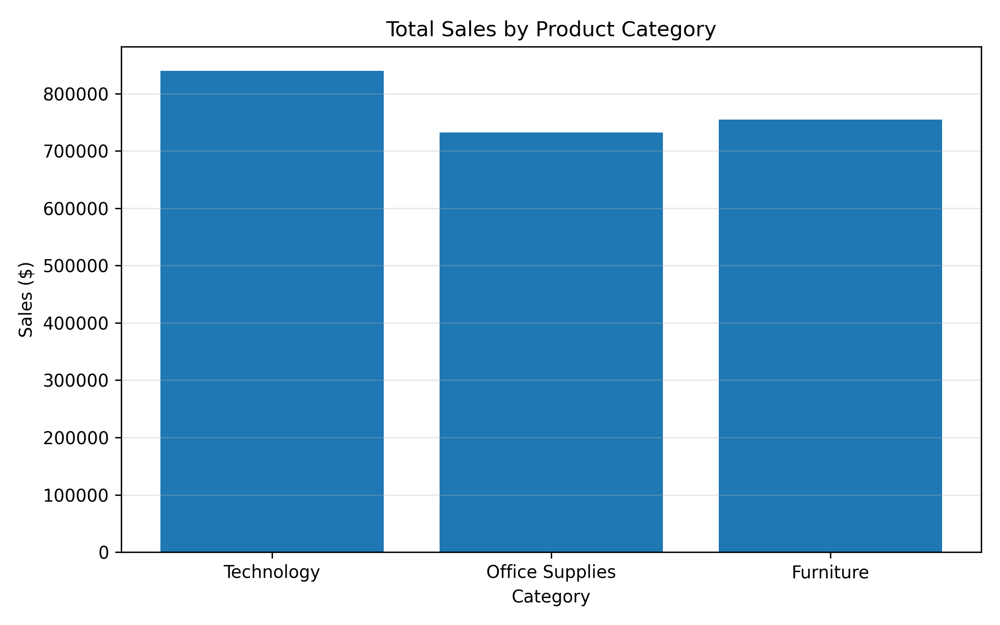
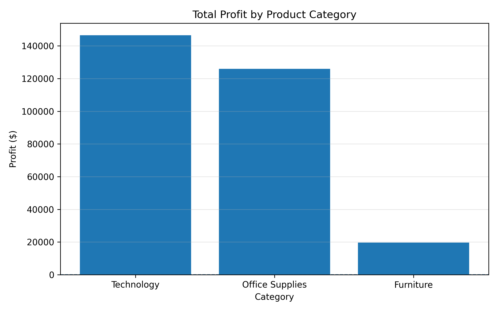
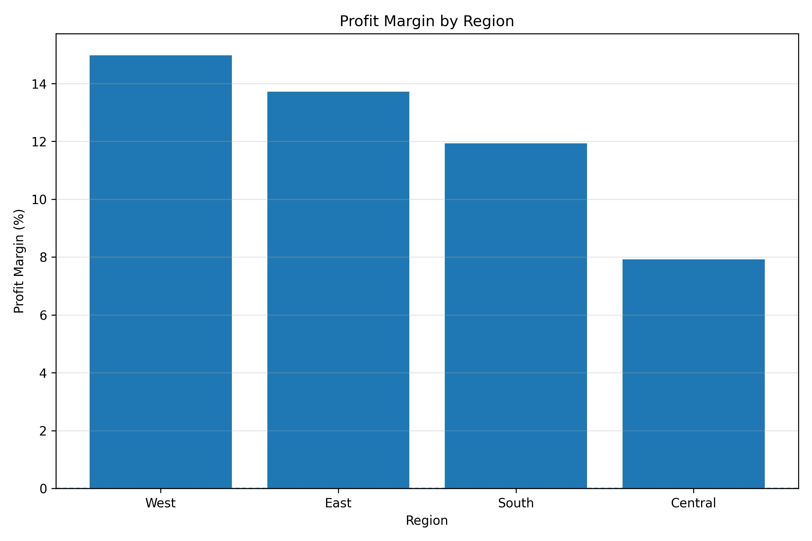
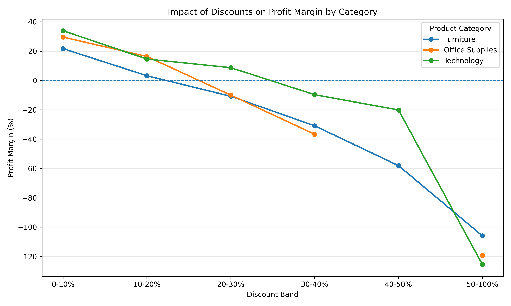
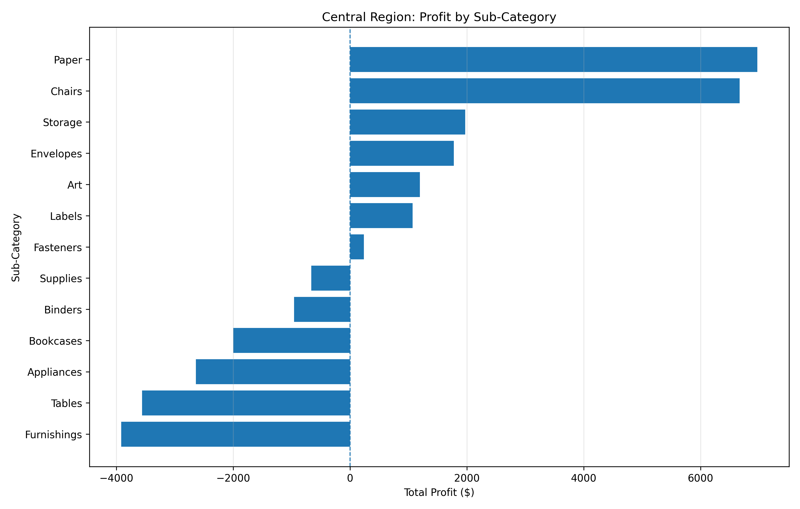
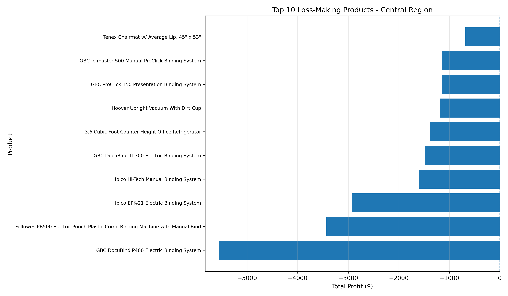

# Retail Sales & Profitability Analysis

*A Python-based exploratory data analysis project investigating retail sales performance, product profitability, regional performance and discount strategies.*

## 1. Project Overview

This project uses Python to analyse retail sales data and investigate business profitability.

The objective is to identify sales trends, evaluate product and regional performance, investigate discount strategies, and provide actionable recommendations to improve business profitability.

The dataset contains **10,194 records and 21 original columns**.

## 2. Dataset Source

- **Dataset:** Superstore Sales (Sample - Superstore)
- **Provider:** Tableau Public
- **Source:** https://public.tableau.com/app/learn/sample-data

The dataset was obtained from Tableau's official sample data collection. It contains fictional retail sales information, including products, customers, sales, discounts and profits.

The dataset is used exclusively for educational and portfolio analysis. The original dataset was not created by me.

## 3. Business Questions

This project investigates five key business questions:

1. Which product categories generate the highest sales and profit?
2. Which regions perform best and worst financially?
3. Which product sub-categories are generating losses?
4. How are discount levels associated with profitability?
5. Which products and business areas should management investigate?

## 4. Tools and Technologies

| Tool | Purpose |
|---|---|
| Python 3.13 | Programming language |
| Pandas | Data cleaning, transformation and analysis |
| Matplotlib | Data visualisation |
| VS Code | Development environment |
| Git and GitHub | Version control and portfolio presentation |

## 5. Data Preparation

The analysis included:

- Loading the CSV dataset using Pandas.
- Handling CSV encoding.
- Converting order and shipping dates into datetime formats.
- Checking missing values and duplicate records.
- Validating data types.
- Creating additional features:
  - Shipping Days
  - Order Year
  - Order Month

No missing values or duplicate rows were identified in the dataset.

## 6. Key Performance Indicators

| KPI | Result |
|---|---:|
| Total Sales | $2,326,534.35 |
| Total Profit | $292,296.81 |
| Total Units Sold | 38,654 |
| Total Orders | 5,111 |
| Total Customers | 804 |
| Profit Margin | 12.56% |
| Average Order Value | $455.20 |
| Average Discount | 15.54% |

*Note: Monetary values use the `$` symbol in this analysis. The dataset's specific currency has not been independently verified.*

## 7. Key Business Findings

### Finding 1: Technology is the strongest product category

Technology generated $839,893.28 in sales and $146,543.38 in profit, achieving a 17.45% profit margin.

Furniture generated $754,747.76 in sales but only $19,730.00 in profit, resulting in a much lower margin of 2.61%.

### Finding 2: Central is the weakest-performing region

The West region achieved the highest profit margin at 14.98%.

Central recorded the lowest profit margin at 7.92%, despite generating more sales than the South region.

### Finding 3: Some product sub-categories are loss-making

Tables, Bookcases and Supplies generated negative overall profit.

Tables recorded the largest loss at $17,753.21, making it a priority for further investigation.

### Finding 4: Higher discounts are associated with lower profitability

The analysis identified a clear relationship between higher discount bands and weaker profit margins.

Order lines with discounts above 20% generated negative aggregate profit across the overall dataset.

This indicates a potential pricing and discount-management issue. However, the analysis identifies an association rather than proving that discounts alone caused the losses.

### Finding 5: Central's high-discount transactions require attention

The Central-region high-discount subset analysed generated a net loss of $50,103.43.

The five most loss-making products in this analysis were Binders products with average discounts of approximately 80%. Together, they accounted for $14,995.22 in losses.

## 8. Business Recommendations

Based on the findings, the following actions are recommended:

1. **Review discount policies:** Introduce approval controls for unusually high discounts and monitor their impact on profit margins.
2. **Investigate Furniture profitability:** Review pricing, costs and discount practices for Tables, Bookcases and Furnishings.
3. **Investigate Central region performance:** Focus on loss-making product groups and underperforming categories.
4. **Protect profitable categories:** Identify opportunities to maintain and grow Technology's strong profitability.
5. **Monitor business performance:** Develop a profitability dashboard tracking sales, profit, discounts, categories and regions.

## 9. Project Visualisations

The project includes six charts highlighting key findings.

### Sales by Category



### Profit by Category



### Profit Margin by Region



### Discount Impact by Category



### Central Sub-category Profit



### Top 10 Loss-making Products



The project also exports seven analysis tables into `outputs/tables/`.

## 10. Project Structure

```text
.
├── data/
│   └── raw/
│       └── project1.csv       # Download separately; not committed
│
├── outputs/
│   ├── charts/
│   │   └── *.png
│   └── tables/
│       └── *.csv
│
├── analysis.py
├── README.md
├── requirements.txt
└── .gitignore
```

## 11. How to Run This Project

### Prerequisites

- Python 3.13 or a compatible Python version
- Git

### Step 1: Clone the repository

```bash
git clone https://github.com/man06122005-sketch/retail-sales-profitability-analysis.git
```

### Step 2: Create and activate a virtual environment (Windows)

```bash
python -m venv .venv
.venv\Scripts\activate
```

### Step 3: Install dependencies

```bash
python -m pip install -r requirements.txt
```

### Step 4: Download the dataset

Download the Superstore sample dataset from Tableau Public:

https://public.tableau.com/app/learn/sample-data

Create the `data/raw/` folder if it does not exist, and place the downloaded CSV file there using this filename:

```text
data/raw/project1.csv
```

The raw dataset is excluded from the Git repository.

### Step 5: Run the analysis

```bash
python analysis.py
```

The analysis tables and charts will be exported into the `outputs/` folder.

## 12. Skills Demonstrated

- Python programming
- Pandas data manipulation
- Data cleaning and preprocessing
- Exploratory Data Analysis (EDA)
- Business KPI calculation
- GroupBy and aggregation
- Data visualisation
- Profitability analysis
- Business problem-solving
- Data-driven recommendations

---

**Project Type:** Data Analytics Portfolio Project

**Focus:** Retail Sales, Business Performance and Profitability Analysis